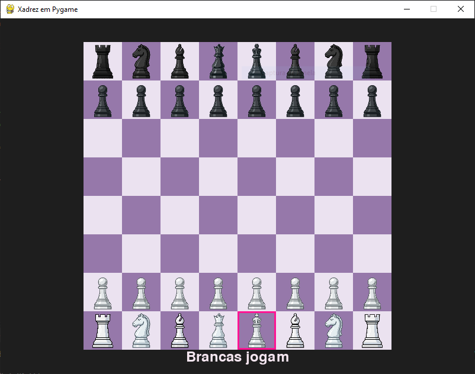
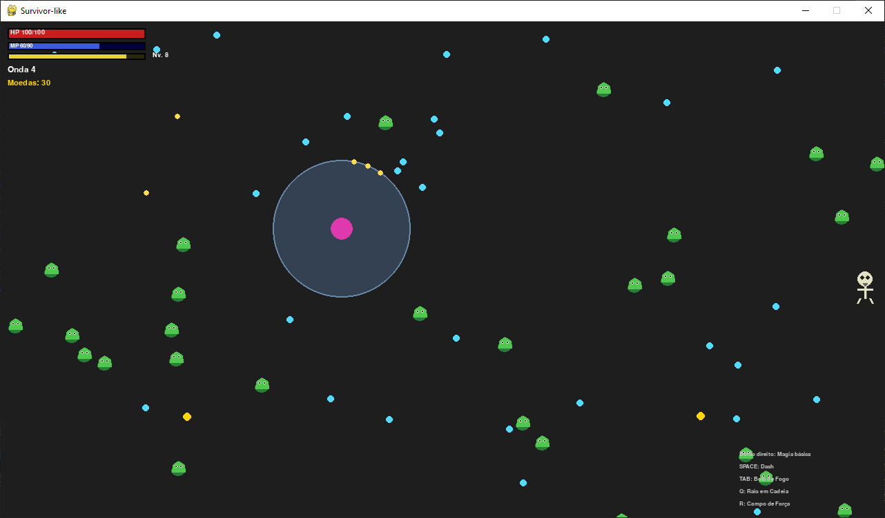
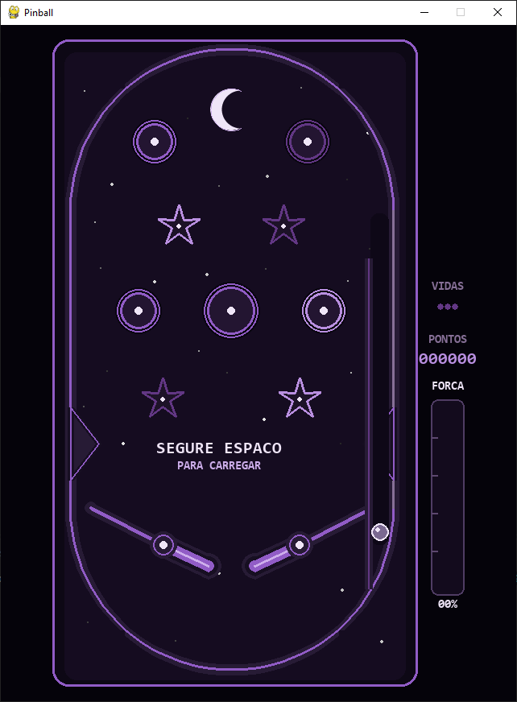

# 🎮 Jogos em Pygame

Coleção de jogos desenvolvidos em Python com pygame: um jogo de xadrez, um roguelike survivor e um pinball.

Todos os assets foram desenvolvidos usando IA e adaptados para cada jogo

## 🕹️ Jogos

### ♟️ Xadrez
Jogo de xadrez com tabuleiro e peças desenhados em pygame.
- **Status:** completo
- **Controles:** clique do mouse para selecionar e mover as peças
- **Regras implementadas:** movimento das peças, roque, peão com avanço de 2 casas, en passant ...
- **Executar:** `python Chess/main.py`

### 🧟 Roguelike Survivor
Jogo no estilo Vampire Survivors: sobreviva a ondas de inimigos, evolua e fortaleça seu personagem.
- **Status:** incompleto
- **Controles:**
  WASD ou setas: mover
  Espaço: dash
  Botão direito do mouse: magia básica, mirando no cursor
  Tab: bola de fogo
  Q: raio em cadeia
  E: nevasca na direção do cursor
  R: campo de força...
- **Destaques:** sistema de XP e raridade de upgrades, ondas infinitas, loja
- **Executar:** `python RoguelikeSurvivor/main.py`

### 🔵 Pinball
Mesa de pinball com física de bola, flippers e pontuação.
- **Status:** Completo
- **Controles:** Segure espaço para iniciar e aperte espaço para mover os flippers
- **Destaques:** colisão da bola com bumpers e paredes, placar de pontuação, vidas e histórico
- **Executar:** `python Pinball/main.py`

